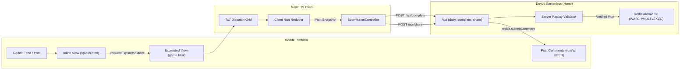

# DeadDrop Route

> **Night Shift Courier Dispatch** — A tactical daily spatial routing puzzle built for Reddit via Devvit Web.

[](https://developers.reddit.com/apps/deaddrop-route)
[](https://www.reddit.com/r/deaddrop_route/comments/1y5ktt8/deaddrop_route/)
[](LICENSE)
[](src)

[**🕹️ Launch Playable Game on Reddit**](https://www.reddit.com/r/deaddrop_route/comments/1y5ktt8/deaddrop_route/) • [**App Directory Listing**](https://developers.reddit.com/apps/deaddrop-route)

---

## Overview

**DeadDrop Route** is a tactile, retro-industrial spatial delivery puzzle running natively inside Reddit posts.

Every day at **00:00:00 UTC**, a fresh city sector grid unlocks globally. Players step into the role of a clandestine night-shift courier navigating a 7×7 urban district grid to drop off three sensitive lockbox parcels before sunrise. Every maneuver consumes limited transit budget: congestion drains extra fuel, power relays restore emergency reserves, and every decision impacts your daily star rating and courier streak.

Built for the **Reddit Game of the Day Hackathon 2026**, DeadDrop Route pairs modern web tech (React 19, Tailwind CSS 4, Vite 8) with Reddit's serverless runtime (Hono, Devvit Redis, Reddit API) for an ultra-fast, zero-friction daily ritual that lives directly in the feed.

---

## Gameplay & Rules

```text
[HQ] ── · ── · ── [+2] ── [D1] ── ⚡ ── [D2] ── ■ ── [D3]
Depot   Road  Road  Traffic  Parcel  Relay   Parcel  Wall   Parcel
```

### Objective
Deliver all 3 packages (**D1**, **D2**, **D3**) in any sequence before exhausting your move budget. There is no need to return to HQ after your final delivery.

### District Grid Elements

| Tile Element | Symbol | Move Cost / Effect | Gameplay Rule |
| :--- | :---: | :---: | :--- |
| **Dispatch Depot** | `HQ` | Starting Hub | Your courier van starts here at shift initialization. |
| **Clear Roadway** | `·` | **1 move** | Standard asphalt transit pavement. |
| **Congested Sector** | `+2` | **2 moves** | Gridlocked intersections; entering requires $\ge 2$ remaining moves. |
| **Emergency Relay** | `⚡` | **+2 bonus** | Restores 2 moves to remaining budget on first entry (turns into `○` thereafter). |
| **Dead Drop** | `D1–D3` | Delivery Target | Lockbox destinations. Can be visited in **any order**. |
| **Blocked Building** | `■` | Impassable | Concrete structures and barriers; cannot be traversed. |

### Performance Ratings
- **3 Stars (`★★★`)**: Solved within optimal par moves ($\le \text{par}$).
- **2 Stars (`★★☆`)**: Solved within $\text{par} + 2$ moves.
- **1 Star (`★☆☆`)**: Completed beyond $\text{par} + 2$ moves.
- **0 Stars (`☆☆☆`)**: Out of transit moves before all 3 deliveries are completed.

### Controls
- **Mobile Touch**: Tap any adjacent, legal tile highlighted on the 7×7 board.
- **Desktop Keyboard**: Use **Arrow Keys** or **WASD** (`W` Up, `A` Left, `S` Down, `D` Right).

---

## Architecture

DeadDrop Route utilizes a dual-entrypoint Devvit Web architecture paired with a serverless Hono backend and transactional Redis persistence.



---

## Key Features

- **Dual-Entrypoint Architecture**:
  - `splash.html`: Ultra-lightweight inline view rendered directly in the feed. Displays current status (*"INITIALIZE RUN"* vs. *"VIEW RESULT"*) with instantaneous launch.
  - `game.html`: Responsive full-screen expanded interactive view loaded seamlessly via `requestExpandedMode`.
- **Deterministic UTC Day Rotation**:
  - Puzzles rotate synchronously worldwide at `00:00:00 UTC` based on elapsed UTC calendar days:
    $$\text{map} = \text{seeds}[\text{dayIndex} \pmod{15}]$$
  - Cycles through 15 hand-crafted, distinct urban sectors, each pre-solved and par-calibrated at build time with an automated BFS solver.
- **Server-Authoritative Anti-Cheat Verification**:
  - Client submits only the raw directional move path (`path: Direction[]`).
  - `POST /api/complete` replays the submitted path step-by-step from the depot against the authoritative daily map before awarding stars, updating streaks, or persisting results.
- **Atomic Redis Persistence**:
  - User streaks and daily completions are protected by Redis `WATCH` / `MULTI` / `EXEC` transaction locks with optimistic concurrency retries.
  - Enforces strict same-day idempotency (`user:{id}:completed:{dayIndex}`): players cannot inflate scores or re-roll daily streaks.
- **Zero-Fake-Activity Telemetry Policy**:
  - If today's verified player completions are below the threshold (`TRAFFIC_THRESHOLD = 5`), the EndCard displays *"BE THE FIRST TO ROUTE"*.
  - No synthetic bots, mock counters, or fabricated numbers are ever displayed. Once $\ge 5$ players complete the route, real dispatch counts and community traffic heatmaps are surfaced.
- **Native User-Triggered Reddit Comment Sharing**:
  - Completing a route unlocks the option to publish a formatted shift dispatch report directly into the Reddit post comments.
  - Executed via `POST /api/share` calling `reddit.submitComment({ id: postId, text, runAs: 'USER' })` strictly on behalf of the authenticated user.
- **Responsive Viewport & Accessibility**:
  - Self-contained, zero-scroll interface engineered to fit desktop monitors and narrow 375px mobile screens with $\ge 44\text{px}$ touch targets.
  - Tile buttons enforce `disabled={!isLegalMove}`, preventing accidental illegal taps on walls or unaffordable congested tiles.
  - Screen readers receive real-time tile identities and accessible legal-move announcements.

---

## Technology Stack

| Layer | Technologies & Tools |
| :--- | :--- |
| **Frontend** | React 19, Tailwind CSS 4, Vite 8, TypeScript 6 |
| **Backend** | Node.js v22 runtime, Hono 4, Devvit Web Server (`@devvit/web/server`) |
| **Storage & Data** | Devvit Redis (`@devvit/redis`) with atomic multi-key transactions |
| **Platform APIs** | Devvit Web Client (`@devvit/web/client`), Reddit API (`@devvit/reddit`) |
| **Testing & Tooling** | Node.js native test runner (`node:test`, `node:assert`), ESLint 10, Prettier |

---

## Local Development & Setup

### Prerequisites
- **Node.js**: `v22.x` (enforced via `.nvmrc` and `package.json` engines).
- **Devvit CLI**: Installed locally via `@devvit/cli` (`npm install`).
- **Reddit Account**: Registered with Reddit Developer Platform access.

### Quick Start
```bash
# 1. Clone repository
git clone https://github.com/Tuxhar01/deaddrop-route.git
cd deaddrop-route

# 2. Install dependencies
npm install

# 3. Authenticate with Reddit Devvit
npm run login

# 4. Start local playtest daemon (in a test subreddit you moderate)
npm run dev
```

---

## Testing & Quality Verification

DeadDrop Route includes comprehensive test suites spanning the shared rules engine, BFS shortest-path solver, client state machine, server route security, Redis concurrency, and UI accessibility constraints:

```bash
# Run all 149 unit tests across 23 test suites
npm run test:unit

# Strict TypeScript type check (enforces noUnusedLocals & noUnusedParameters)
npm run test:types

# Lint all TypeScript and React sources
npm run lint

# Validate build-time BFS solvability for all 15 map seeds
npm run verify:seeds

# Production asset bundle build (verify-seeds + vite build)
npm run build

# Run end-to-end player flow simulation (cold start, BFS, replay, share)
node --experimental-strip-types --no-warnings=ExperimentalWarning scripts/cold-start-verification.ts
```

All 6 verification gates pass with **0 errors, 0 warnings, and 0 type casting**.

---

## Project Status & Useful Links

- **Release Version**: `v0.0.2`
- **Release Commit**: `8a4fec8ea448c9f4fa381c30272c776a5a6bc8e4`
- **Playable Reddit Post**: [https://www.reddit.com/r/deaddrop_route/comments/1y5ktt8/deaddrop_route/](https://www.reddit.com/r/deaddrop_route/comments/1y5ktt8/deaddrop_route/)
- **Reddit Devvit App**: [https://developers.reddit.com/apps/deaddrop-route](https://developers.reddit.com/apps/deaddrop-route)
- **Source Repository**: [https://github.com/Tuxhar01/deaddrop-route](https://github.com/Tuxhar01/deaddrop-route)

---

## License

This project is licensed under the **BSD-3-Clause License**. See the [LICENSE](LICENSE) file for details.
